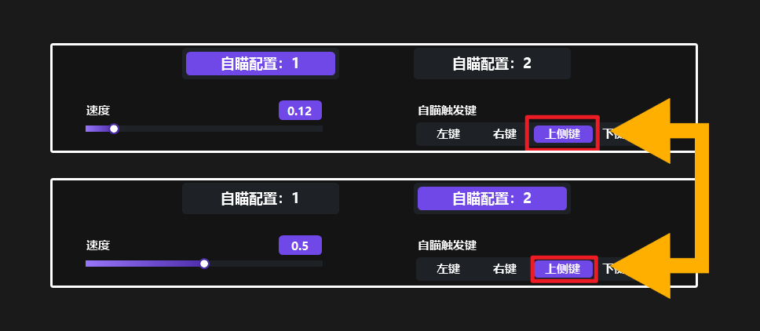

# TOP AI 自瞄安裝使用教學


輔助購買：[https://fishboss.store/shop/top-ai/](https://fishboss.store/shop/top-ai/)


## TOP AI自瞄完整使用教學影片


### 必看教學影片

### 不想看文字，請直接看下面這影片&#xD; 不照教學做的拉屎都沒衛生紙用




## 一、前置作業

### 驅動整合包下載(關防毒的也在這裡面)：[點我前往下載](https://mega.nz/file/3jAzGBDL#so7rFDXB8va8yoF1Bqm3stUUvDHfGLXPTl-8e4b-hRA)

### 更改例外語言為 中文(簡體，中國) > 上方影片有教怎麼改語言

<figure><figcaption></figcaption></figure>

### 做完後先重開機，然後繼續往下看


### 第一次使用要調整的東西比較多，如果懶得自己用，賣場有提供付費遠端服務，直接幫你遠端設定電腦，200元/次


***

## 二、安裝輔助



### 下載AI程式檔案 <a href="https://mega.nz/folder/zvZAQIqQ#AkmKi5lbWum-UKXnP2qQdQ" class="button primary" data-icon="desktop-arrow-down">點我前往下載</a>

<figure><figcaption></figcaption></figure>

<figure><figcaption></figcaption></figure>




### 把檔案直接打開，然後按解壓縮等他跑完跳通知

<figure><figcaption></figcaption></figure>

<figure><figcaption></figcaption></figure>

<figure><figcaption></figcaption></figure>




### _<mark style="color:red;background-color:green;">右鍵管理員身分開啟</mark>_ C槽資料夾內的TOP.exe

<figure><figcaption></figcaption></figure>




### 輸入卡密登入

<figure><figcaption></figcaption></figure>




### <mark style="background-color:pink;">如果卡密顯示不存在，請用資料夾內另一個版本的檔案</mark>

<figure><figcaption></figcaption></figure>

<figure><figcaption></figcaption></figure>




### 選擇你要的模型

### 這邊以特戰為例，黃色瓦<mark style="color:$success;">v11</mark> 代表你DML版本也要選YOLO\_<mark style="color:$success;">v11</mark>

### 模型和版本的<mark style="color:red;">數字必須一樣</mark> 不然會沒效果!!

> #### <mark style="color:$tint;background-color:$success;">推理選擇跟模型選擇有很大的關係</mark> <mark style="color:$tint;background-color:$success;">你要找到你玩的那個遊戲的模型屬於哪類(NCNN或DML) 然後再去選擇相對應的推理模式</mark>

<figure><figcaption></figcaption></figure>

### <mark style="color:red;">這邊非常重要，如果你是筆電，務必使用獨立顯卡去跑AI自瞄</mark>

<mark style="color:orange;">如圖所示: 這個人他獨立顯卡是1 那AI這邊就設定1</mark>

<figure><figcaption></figcaption></figure>

### <mark style="color:yellow;">其他的東西就不用動 跟圖片一樣就好 最後按下加載模型等他跑完</mark>



### 推理設置(懶人直接照下方圖片操作即可)

#### 移動方式請選擇drv 等個幾秒測試移動 滑鼠有動的話就沒問題

<figure><figcaption></figcaption></figure>




### 自瞄設置(<mark style="color:$danger;">速度和範圍</mark>務必調低，其餘可照抄)

#### 目前這個參數是老闆自己<mark style="color:$success;">打瓦用的</mark>，可以直接照抄，如果覺得<mark style="color:red;">自瞄有點太慢</mark>，那就<mark style="color:red;">把速度再拉高就好</mark>，<mark style="color:green;">其他地方都照原本我設定的</mark>

<figure><figcaption></figcaption></figure>



#### <mark style="background-color:$danger;">特別注意:</mark> 近期很多人反應開槍會晃 解決方式是把<mark style="color:purple;">自瞄配置1</mark>和<mark style="color:purple;">自瞄配置2</mark>的<mark style="color:$success;">自瞄觸發鍵</mark>設定成<mark style="color:$primary;">一樣的</mark> 如果你是打特戰，熱鍵推薦設定為右鍵、上側鍵、下側鍵

<figure><figcaption></figcaption></figure>



### 其他設置(這裡都預設不用動)

<figure><figcaption></figcaption></figure>




### 接下來按啟動，上遊戲測試參數

<figure><figcaption></figcaption></figure>




### <mark style="color:$success;">菜單顯示/隱藏熱鍵：INS鍵</mark>



### 教學影片有講一些細節，上面做完再來看就好

#### (如果出現問題，幫我看影片<mark style="color:red;">一步一步確認</mark>)

### <mark style="background-color:$primary;">詳細參數設定教學(沒提到的用預設數值就好)</mark>


[config-tutorial.md](config-tutorial.md)


### 教學影片有講一些細節，上面做完再來看就好

***

## 三、疑難排解

### <mark style="background-color:$danger;">介面無法點、直接卡住沒有跳錯誤窗</mark>

解法：不要開啟自動登入功能

<figure><figcaption></figcaption></figure>

如果已經開了，可以刪除lic.ini這個檔案來重置\
.png>)

### <mark style="background-color:$danger;">輔助閃退/ drv驅動安裝失敗等問題</mark>

1. 確保防毒已經關閉
2. 請務必使用管理員身分開啟輔助檔案(非常重要)
3.  使用warp vpn [點我下載](https://one.one.one.one/) 。下載完畢要安裝，安裝好請在電腦右下角找雲朵圖案，打開來讓他變成下方圖片的樣子

    
<figure><figcaption></figcaption></figure>

### <mark style="background-color:$danger;">自瞄有效 但瞄準位置沒有在敵人身上</mark>



1. 確保遊戲內解析度和電腦螢幕解析度相同
2.  確保電腦螢幕顯示比例為100%

    
<figure><figcaption></figcaption></figure>

3. 最後還是沒有解決，請把所有解析度(遊戲、螢幕)都設定為1920x1080

### <mark style="background-color:$danger;">用了老闆推薦設定，自瞄很慢怎麼辦</mark>

1. 最主要原因是顯卡效能差異，請把自瞄速度拉高即可解決

### <mark style="background-color:$danger;">為什麼自動板機/開槍，沒有效果</mark>

1. 這個功能只對有外接盒子的有作用，比如kmbox-net、makcu等等
