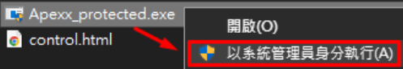
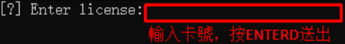
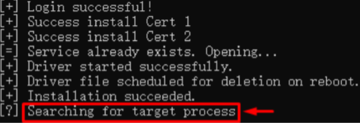
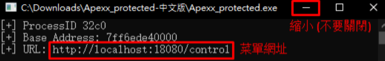
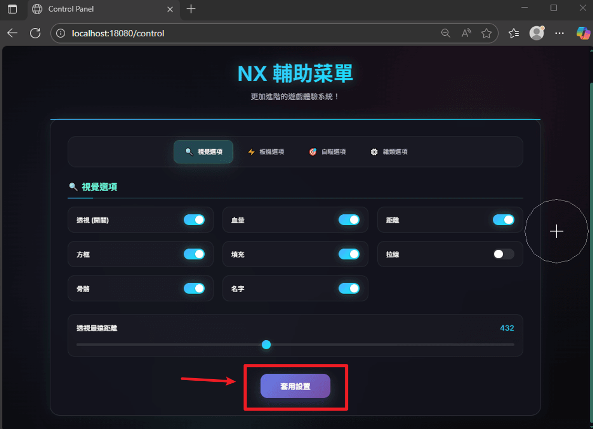

# \[APEX] NX輔助 | 極穩網頁菜單

## 購買請直接在DC內開單，目前魚老闆網站在維護

***

### 一、前置作業 

### 請確保你有把[ 通用前置作業四步驟](https://fishboss.gitbook.io/tutorial) 做完 

### 做完後，請繼續往下看 

***

### 二、安裝輔助 

### 1. 下載輔助 

APEX NX輔助載點 [點我前往下載](https://mega.nz/folder/k04BDYpT#m9hFeAvtNc3oD1UMJxFYTA)

1.  檔案下載好後，放置C槽正下方，請先解壓縮檔案，再以系統管理員身分執行 

    
<figure><figcaption></figcaption></figure>

2.  黑窗內輕點右鍵輸入卡號，輸入完成之後，按 \[ENTER鍵] 送出 

    
<figure><figcaption></figcaption></figure>

3.  看到 Searching for target process 就去打開遊戲 (APEX) 

    
<figure><figcaption></figcaption></figure>

4.  看到 Press any key to continue 請在黑窗按下 \[ENTER鍵] 

    
<figure><figcaption></figcaption></figure>

5.  看到 URL: [http://localhost:18080/control](http://localhost:18080/control) 代表輔助啟動成功了\
    直接點選或複製此網址，即可在瀏覽器打開輔助設定介面 

    
<figure><figcaption></figcaption></figure>

6. 輔助注意事項


輔助注意事項

### 黑色窗口：可以縮小，但請保持執行不要關閉他，否則輔助無效 遊戲內設置：無邊框視窗，否則輔助無效 熱鍵設置：點選要更改的熱鍵選項即可修改 介面設置套用：更改設置後，需點選 \[套用設置] ，才會套用更改效果


<figure><figcaption></figcaption></figure>


請注意不要關閉黑窗，否則輔助無效

### 請注意不要關閉黑窗，否則輔助無效


***

### 三、疑難排解 

### 請確保你有把[ 通用前置作業四步驟](https://fishboss.gitbook.io/tutorial) 做完 

### 查看[疑難排解](https://fishboss.gitbook.io/tutorial/instruction/faq) 
