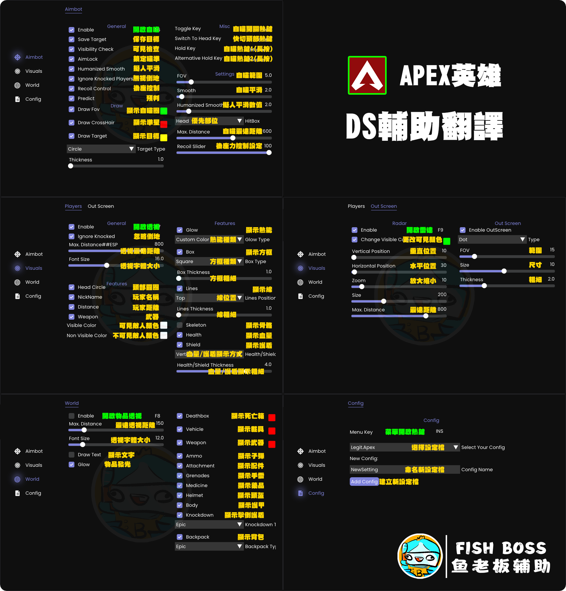

# DS輔助 | 演戲專用

## 輔助購買：[https://fishboss.store/product/apex\_ds/](https://fishboss.store/product/apex_ds/)

***

## 第一步：確認前置作業已完成&#x20;

### <mark style="color:yellow;">請先確認已經做過</mark> [..](../../ "mention") [點我快速前往](../../)

### 必須關閉虛擬化技術和Hyper-V&#x20;


[xu-ni-hua-ji-shu-vt-yu-hyperv-ji-shu.md](../../instruction/preparation/xu-ni-hua-ji-shu-vt-yu-hyperv-ji-shu.md)


## 第二步：安裝輔助


### 輔助檔案：[點我下載](https://mega.nz/file/9XBWkb5B#A9Iv0efvZrzwiaCUEkVyCGpgoQOKkobwNWza8zXE484)

### 解壓縮工具(務必安裝解壓工具)： [點我下載](https://www.rarlab.com/rar/winrar-x64-701tc.exe)


### 1. 下載輔助檔案，下來後解壓縮檔案

### 2. 安裝Riva Tuner [點我](https://mega.nz/file/pqEh2KyS#4Chpq7jcMsTTa_6g5yycV4F9ksHoyQ02anUdHfo5QpY)，下載下來後解壓縮，然後用管理員身分安裝

<figure><figcaption></figcaption></figure>

### 3. 管理員身分打開RivaTuner Statistics Server

<figure><figcaption></figcaption></figure>

### 4. RivaTuner Statistics Server開啟後，管理員身分打開輔助檔案

### 5. 輸入卡密 > 按LOGIN

<figure><figcaption></figcaption></figure>

### 6. 按INJECT

<figure><figcaption></figcaption></figure>

### 7. 有出現"ok"或"確定"，都直接按，直到出現下方畫面

<figure><figcaption></figcaption></figure>

### 8. 等待輔助注入器消失之後，即可上遊戲爽


遊戲畫面設定必須為 視窗全螢幕 或是 無邊框，否則無效


### 9. 上遊戲後，輔助菜單會自動出現


### **輔助菜單熱鍵：INS鍵 (insert)**

### **如果您的鍵盤沒有 Insert 鍵，您可以按Win + CTRL + O**使用 Windows 螢幕鍵盤。


***

## 輔助菜單翻譯

<figure><figcaption></figcaption></figure>
