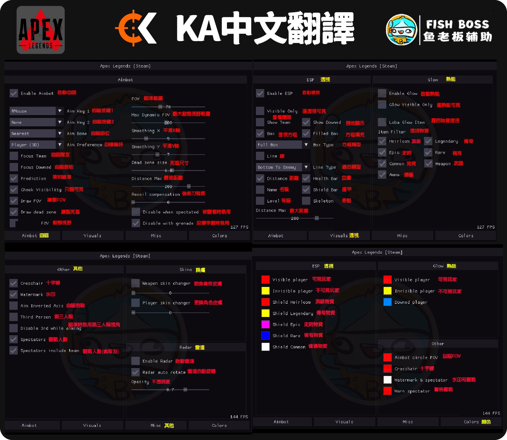

# \[APEX] KA 輔助


輔助購買：[https://fishboss.store/shop/apex-ka/](https://fishboss.store/shop/apex-ka/)


## 一、前置作業

## 請先確認[通用前置作業](../../)有完成，再接著往下看

## 二、安裝輔助

### 第一步：請先下載 STEAM平台[(點我下載steam)](https://store.steampowered.com/about/)

<figure><figcaption></figcaption></figure>

### 下載完請安裝並且登入帳號，之後<mark style="color:red;">放在背景不要關</mark>，接著下載輔助

<figure><figcaption></figcaption></figure>

### 主要載點：[點我前往](https://mega.nz/folder/kfcwAIgZ#Mw0Dr0Pmlh5mhIptkwrbTw)

### 第二步：解壓縮輔助，以管理員身份運行輔助程式。

<figure><figcaption></figcaption></figure>

<figure><figcaption></figcaption></figure>

### 第三步：會跳出下方提示，點確定可直接跳過。 (下方提示內容翻譯: <mark style="color:red;">請把輔助檔案放在USB裡面運行</mark>，注入輔助之後即可拔除USB)

<figure><figcaption></figcaption></figure>


### 魚老闆：雖然KA說要在USB運行程式，

### 但其實直接在電腦執行也是沒問題的(我自己是沒有放在USB內開啟)，

### 穩定度一樣在，但如果<mark style="background-color:green;">追求最穩定</mark>的使用者，

### 那我會<mark style="background-color:green;">建議把檔案放在USB裡面使用</mark>。


### 第四步：輸入卡號 > 點下Login來登入(激活)輔助，之後點 確定

<figure><figcaption></figcaption></figure>

### 第五步：點Start啟動輔助


### 這邊會顯示

#### 你購買的類型(Game):

#### 產品目前狀態(Status): undetected(未被檢測)

#### 卡密到期日(key expiration)


<figure><figcaption></figcaption></figure>

### 第六步：等待輔助加載

<figure><figcaption></figcaption></figure>

### 第七步：加載成功會跳出Successful，一樣點確定，然後就開遊戲 (如果前面是有插著usb的，這時候就可以拔掉了)

### <mark style="color:red;">(遊戲關閉之後 如果想再次使用輔助 請先重新啟動電腦)</mark>

<figure><figcaption></figcaption></figure>


<mark style="color:green;background-color:yellow;">菜單開啟鍵</mark>：INS鍵或是旁邊的HOME鍵\
.png>)
--------------------------------------------


### KA APEX中文化界面，可參考

<figure><figcaption></figcaption></figure>

## 三、疑難排解

### <mark style="color:red;">遇到任何錯誤，請先嘗試重啟電腦</mark>

### 無限轉圈／遊戲無效果

先嘗試不用USB，直接從桌面啟動

### Core Isolation相關錯誤

請先重啟電腦再次測試，還有問題往下方看

還有問題請參照下方這篇，關閉Win內建功能。&#x20;

關閉核心隔離/探索保護:

Win鍵-搜尋核心隔離或core-打開設定-將選項關閉並重啟電腦

<figure><figcaption></figcaption></figure>

### Server連線錯誤(503)

多次反覆嘗試,同樣錯誤可嘗試用:[免費VPN](https://1111-releases.cloudflareclient.com/windows/Cloudflare_WARP_Release-x64.msi)(點我)&#x20;

(請先刪除其他VPN,且只使用我們提供的VPN程序)&#x20;

### Version錯誤問題

重新下載輔助(<mark style="color:red;">主要/備用載點都試</mark>)

### Internal error 相關錯誤

從控制台移除程序:ONE DRIVE (微軟程序)， 然後重啟電腦，如果沒解決，請重灌電腦。

### 其他問題（[點我前往](../../instruction/faq/)）

