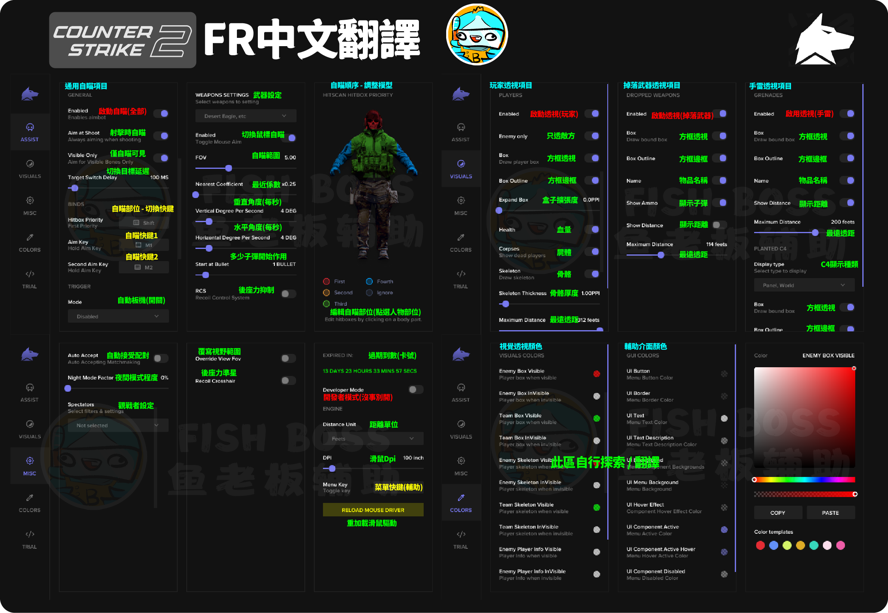

# \[戰地] FR 輔助 | 多版本通用款


輔助購買：[https://fishboss.store/shop/battlefield-fr/](https://fishboss.store/shop/battlefield-fr/)


***

## <mark style="color:yellow;">請先確認已經做過</mark> [..](../ "mention")，確認完畢後，依照下面流程打開輔助

## 第一步：下載輔助檔案

#### 載點：[點我前往](https://mega.nz/folder/SR9BBTAB#f3zC1q8hBFKYShxG3cjHug)

## 第二步：開啟輔助檔案

### 請看下方操作，版本不同可能有不同開啟方式，但大多操作皆相同






**如果成功開啟，FR程式會自動把自己刪除，以防止檢測風險**

<mark style="color:red;background-color:yellow;">**遊戲使用輔助後，只要電腦沒重啟，遊戲重開效果還在。**</mark> \ <mark style="color:red;background-color:yellow;">**不要使用輔助的話，請重啟電腦就可以關閉輔助成功喔！**</mark>


## <mark style="color:yellow;">**下方是卡密激活成功的樣子**</mark>

> ### **之後電腦會自動重開機，開機完直接開遊戲就好**

<figure><figcaption></figcaption></figure>




菜單開啟熱鍵

### INS鍵：開啟 / 隱藏菜單


## 輔助介面翻譯圖


這邊是cs2的 戰地6還沒有開 目前拍不了 先參考一下下面的 之後我再更新戰地的版本上來


<figure><figcaption></figcaption></figure>

#### FR輔助開啟方式

(遊戲請設置<mark style="color:red;">無邊框 / 視窗化</mark>遊玩，否則輔助使用無效)&#x20;

遊戲設置：至少開過1次遊戲 + 視窗化&#x20;

至少開過1次遊戲的定義：打開遊戲到大廳過&#x20;

視窗化的定義：遊戲設置為【無邊框 / 視窗化】&#x20;

沒有開過遊戲就先開FR輔助：會導致遊戲損毀 （<mark style="color:red;">需重開機 + 移除遊戲 + 重新啟動器，然後重裝遊戲</mark>）

## 疑難排解

### 卡號輸入無效/無限輸入卡號

1.可能輔助下載錯遊戲,重下載正確的遊戲輔助即可!

2.刪除桌布軟體(WallpaperEngine)或其他桌布程序&#x20;

3.如果還有問題,代表卡號需解綁

### 開啟遊戲後閃退/重啟後無法使用

請使用FR資源包中的<mark style="color:red;">備用啟動器</mark>來啟動輔助，不過還是<mark style="color:red;">需要把本體exe程序丟在裡面</mark>才能用&#x20;

(使用方法和教學相同,只是從資料夾內開)

(輔助自動重啟上遊戲後,需等待2分鐘出菜單)

<figure><figcaption></figcaption></figure>

### AMD Spoofer not implemented 報錯提示

因為部分遊戲的過機碼功能,暫時還不支援AMD核心。

請用直接啟動輔助的方式，<mark style="color:red;">不要使用過機碼功能。</mark>

### 其他問題

1.只要電腦沒有重啟，效果都會在(<mark style="color:red;">關閉輔助=重啟電腦</mark>)

2.如果輔助菜單叫不出來，嘗試更新Windows版本

\
 
