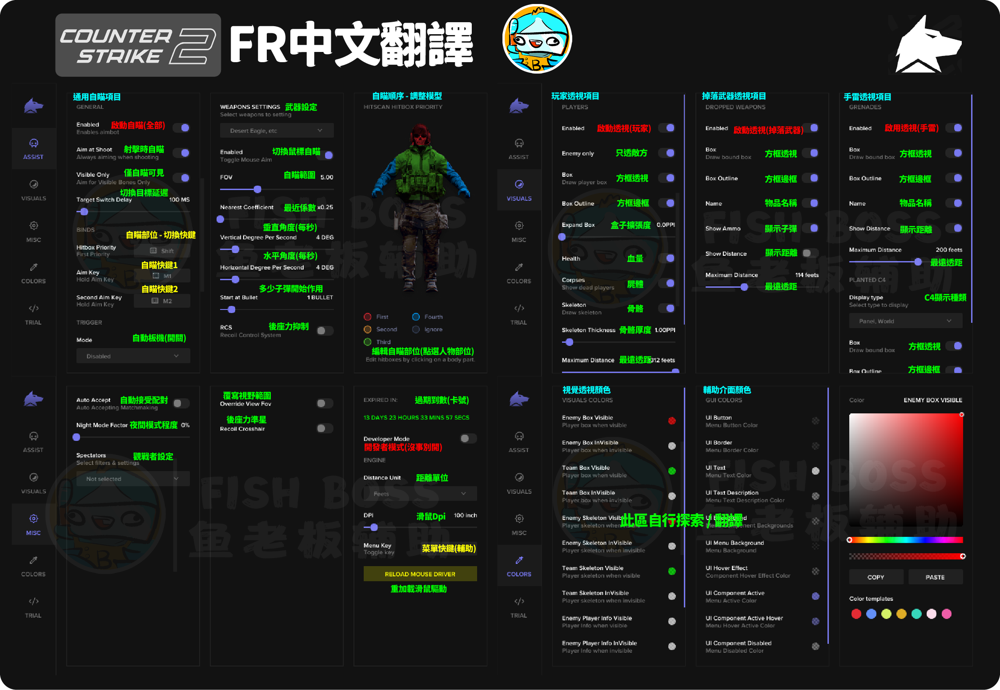

# FR 內部驅動

## <mark style="color:yellow;">請先確認已經做過</mark> [..](../../ "mention")，確認完畢後，依照下面流程打開輔助

## 第一步：下載輔助檔案

#### 載點：[https://reurl.cc/RyqG9z](https://mega.nz/folder/yRsWyI7b#YR0_Z6Xxl1HoI9Z22n62Nw)

###

## 第二步：開啟輔助檔案

### <mark style="background-color:green;">A版</mark> : 輔助優化較差，電腦<mark style="background-color:yellow;">開啟成功率高</mark>。(無過機碼)&#x20;


[a-ban-ben-tui-jian-shi-yong-ci-ban-ben.md](a-ban-ben-tui-jian-shi-yong-ci-ban-ben.md)


### <mark style="background-color:green;">B版</mark> : 輔助優化較高，電腦<mark style="background-color:yellow;">開啟成功率低</mark>。(有過機碼) (intel用戶可嘗試B版使用，失敗的話就用A版即可)


[b-ban-ben.md](b-ban-ben.md)



**如果成功開啟，FR程式會自動把自己刪除，以防止檢測風險**

<mark style="color:red;background-color:yellow;">**遊戲使用輔助後，只要電腦沒重啟，遊戲重開效果還在。**</mark> \ <mark style="color:red;background-color:yellow;">**不要使用輔助的話，請重啟電腦就可以關閉輔助成功喔！**</mark>


## <mark style="color:yellow;">**下方是卡密激活成功的樣子**</mark>

> ### **之後電腦會自動重開機，開機完直接開遊戲就好**

<figure><figcaption></figcaption></figure>





## 輔助介面翻譯圖

<figure><figcaption></figcaption></figure>
