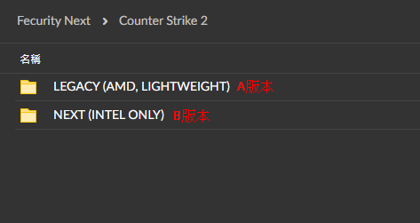
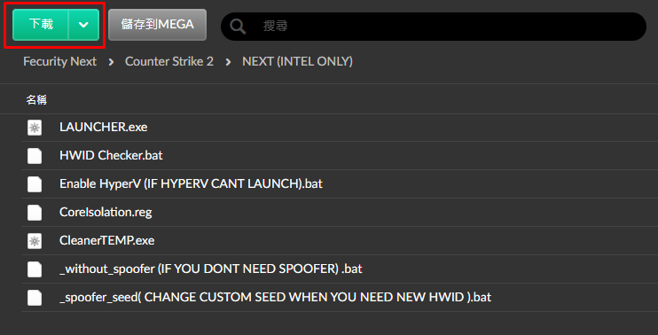

# B版本

## 第一步：選擇A版本

<figure><figcaption></figcaption></figure>

## 第二步：下載檔案

直接點這個下載

<figure><figcaption></figcaption></figure>

## 第三步：解壓縮之後用管理員身份開啟下面圈起來的檔案

<figure><figcaption></figcaption></figure>

<figure><figcaption></figcaption></figure>

## 第四步：輸入卡密

<figure><figcaption></figcaption></figure>


**請確認該畫面沒有任何紅色字。**\
**有**<mark style="color:red;">**紅色字**</mark>**可以先重開機再試試，重開機後如果**<mark style="color:red;">**還是紅字**</mark>**，請再次**<mark style="color:yellow;">**確認前置作業有做完整**</mark>






## <mark style="color:yellow;">**下方是卡密激活成功的樣子**</mark>

> ### **之後電腦會自動重開機，開機完直接開遊戲就好**

<figure><figcaption></figcaption></figure>
