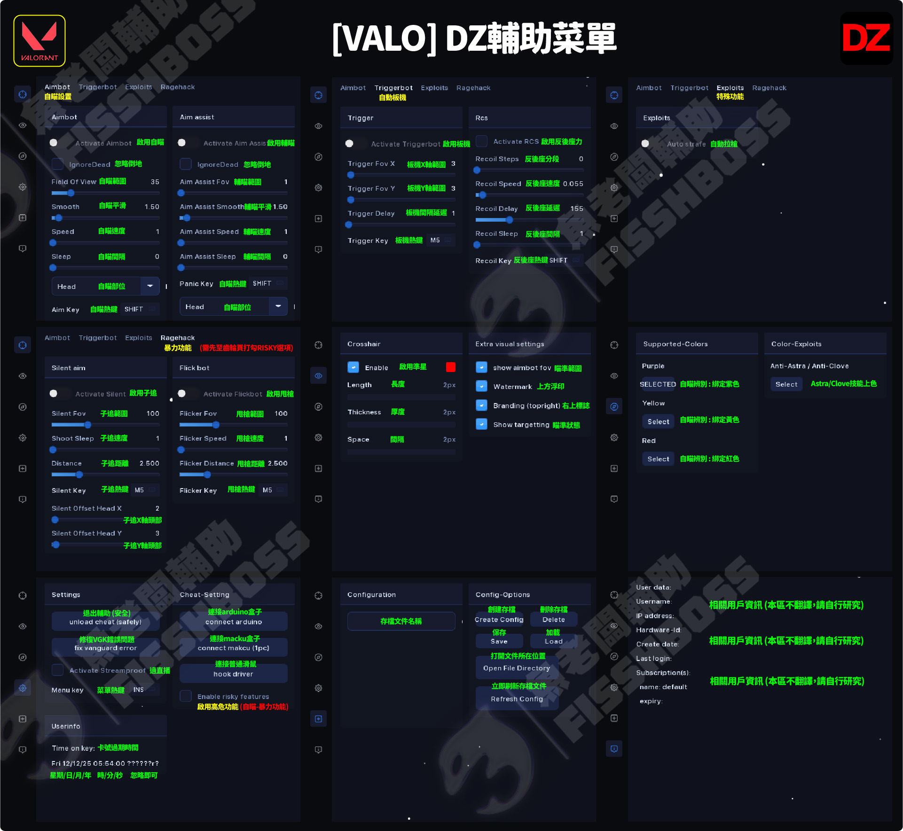

# \[特戰] DZ 找色自瞄 (停賣)


## 輔助購買：[https://fishboss.store/shop/valorant-dz/](https://fishboss.store/shop/valorant-dz/)


***

## 第一部分：三大前置作業(必須完整看完並且符合要求，<mark style="color:red;">否則100%無法使用</mark>)


[dezl-qian-zhi-she-ding-bi-zuo.md](dezl-qian-zhi-she-ding-bi-zuo.md)



[dezl-dian-nao-she-ding-bi-zuo.md](dezl-dian-nao-she-ding-bi-zuo.md)


***

## 第二部分：安裝輔助

### 1. 下載輔助：[點我下載](https://mega.nz/folder/KyJnQLoS#YT6jiUl4OVoYqy2tmdAL2A)

<figure><figcaption></figcaption></figure>

### 2. 解壓縮檔案到C槽(檔案放置於純英文或數字的資料夾內)

<figure><figcaption></figcaption></figure>

#### <mark style="color:$success;">這邊注意一下，新版/測試版 每次開啟輔助檔案會自動刪除，所以每次要用請重新解壓縮</mark>

### 3. 先打開遊戲，進入靶場

<figure><figcaption></figcaption></figure>

### 4. 啟動輔助 > 右鍵管理員身分

<figure><figcaption></figcaption></figure>

#### <mark style="background-color:$success;">再次提醒，輔助每次開啟都會自動刪除以提高安全性，每次使用皆需要重新解壓縮</mark>

### 4-1. 可能會跳出窗口，都點確定/OK即可

> #### 如果沒開HVCI核心隔離，它會自動幫你打開並重開機

### 4-2. 直到看到成功提示，點確定之後繼續往下操作

<figure><figcaption></figcaption></figure>

### 5. 提前複製好卡密，CTRL+C

### 6. 輸入卡密 > 按 \[INS鍵] 叫出菜單 > CTRL+V貼上 > 登入


## 務必注意

#### 如果沒有在10秒內貼上卡密並登入，輔助會自己退出並關閉

#### 如果輔助自動關閉了，可以嘗試再次打開輔助(不用重開遊戲)


<figure><figcaption></figcaption></figure>

### 6. 顏色綁定(必做設定) 否則自瞄無效

> #### 跟著下面圖片操作即可

<figure><figcaption></figcaption></figure>

<figure><figcaption></figcaption></figure>


### 遊戲內敵人顏色必須和輔助這邊的COLOR設定一樣 否則無自瞄

### 遊戲內敵人顏色必須和輔助這邊的COLOR設定一樣 否則無自瞄

### 遊戲內敵人顏色必須和輔助這邊的COLOR設定一樣 否則無自瞄


### 7. 激活功能 > 叫出菜單(INS鍵)&#x20;

### 輔助菜單(INS鍵) > \[設定分頁] > 按\[Hook Driver]

<figure><figcaption></figcaption></figure>

> #### 如果你是有arduino盒子 / makcu盒子，可以自行選擇另外兩項連接方式

### 8. 重新啟動電腦 (重新啟動之後 再次跑上面的步驟 才會有自瞄效果)


### 注意&#x20;

### 只有第一次使用需要重新啟動 因為要讓那個hook工具生效

### 之後使用就是打開來操作到hook就好 不用重啟電腦


### 9. 菜單熱鍵


### 菜單熱鍵

### INS鍵(隱藏/顯示)


***

### 注意:

#### 建議<mark style="color:red;">只開啟Aimbot</mark>，其他後座力控制、暴力設定頁面的功能都別開(<mark style="color:red;">有封號風險</mark>)

***

## 輔助翻譯(新版本翻譯)

<figure><figcaption></figcaption></figure>

***

## 疑難排解


[dezl-yi-nan-pai-jie.md](../../zheng-bei-ting-mai-qu/dezl/dezl-yi-nan-pai-jie.md)

