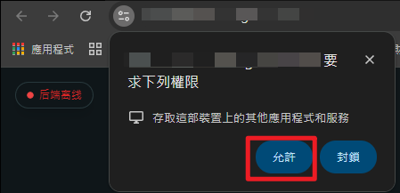

# \[特戰] SC換膚輔助


輔助購買：[https://fishboss.store/shop/valo-sc/](https://fishboss.store/shop/valo-sc/)


## 一、前置作業

### 請先跟著影片操作前置作業(關防毒、載驅動) [驅動整合包下載](https://mega.nz/file/3jAzGBDL#so7rFDXB8va8yoF1Bqm3stUUvDHfGLXPTl-8e4b-hRA)



### 幫你省流：<mark style="color:$danger;">關防毒、載驅動</mark>(其他不用做)

### 做完後請將<mark style="color:$danger;">防火牆關閉</mark>，並繼續按照以下步驟

<figure><figcaption></figcaption></figure>

### <mark style="color:$danger;">!!!注意</mark>:若有自行安裝的防毒軟體請解除安裝或關閉

### 最後檢查<mark style="color:$danger;">核心隔離</mark>是否開啟(若沒開啟將<mark style="background-color:$danger;">導致電腦自動關機</mark>)

<figure><figcaption></figcaption></figure>

### 做完<mark style="color:$danger;">重開機</mark>，並接著往下操作

## 二、安裝輔助

### <mark style="background-color:$danger;">特戰換膚器這類型的所有產品在近期被發現比較容易因為</mark><mark style="color:$success;background-color:$danger;">吊飾和最終擊殺特效</mark><mark style="background-color:$danger;">造成產品</mark><mark style="color:violet;background-color:$danger;">不穩</mark><mark style="background-color:$danger;">，7/8已更新高穩定版本，</mark><mark style="color:blue;background-color:$danger;">移除網頁端控制功能與風險功能</mark><mark style="background-color:$danger;">，回歸最安全且原始的遊戲內換膚</mark>

### 1.將換膚輔助下載並解壓縮到桌面 ([點我下載](https://mega.nz/folder/3qhFzZLQ#eO4eV4fXrAJfKtiii75l-g)) (解壓密碼:123)

### <mark style="background-color:$success;">（此版本沒有網站，只能透過 CMD 運行，使用更方便、更安全）</mark>

### <mark style="background-color:blue;">使用方式和原本相同，只是改由黑窗介面登入換膚</mark>

<figure><figcaption></figcaption></figure>

### 2.以<mark style="color:$danger;">管理員身分</mark>啟動輔助，有跳出要求權限請允許，否則輔助無效。

<figure><figcaption></figcaption></figure>

### 3. 接著開始註冊和輸入卡密，註冊完成後先不要登入

<figure><figcaption></figcaption></figure>

### 4. 註冊帳號注意事項:

* #### 用戶名請<mark style="color:$danger;">獨特</mark>一點，須為<mark style="color:$danger;">英文或數字</mark>，重複的話會失敗 (舉例：`fishboss6767`)
* #### 密碼盡可能簡單，因為沒人能盜用，自己記得住比較重要
* #### <mark style="color:$danger;">禁止</mark>使用特殊字元（`#`、`@`、`!`、`_`、`/`、`-` 、`空格`等等）
* #### 輸入信箱時不需是真實信箱，結尾是@gmail.com即可

## 三、輔助操作

### 1. 首先將遊戲的顯示模式改為「<mark style="color:$danger;">視窗化全螢幕</mark>」，儲存後重開遊戲

<figure><figcaption></figcaption></figure>

### 2. 再次進入遊戲後先到<mark style="color:$danger;">收藏/背包</mark>畫面

<figure><figcaption></figcaption></figure>

### 3. 回到剛剛的黑窗登入輔助，打上剛剛註冊的帳密

### 4. 登入成功之後，請<mark style="color:$danger;">回到遊戲背包點一下畫面</mark>


### 非常重要

### 登入成功之後，請<mark style="color:$danger;">回到遊戲背包點一下畫面來導入換膚</mark>

### 登入成功之後，請<mark style="color:$danger;">回到遊戲背包點一下畫面來導入換膚</mark>

### 登入成功之後，請<mark style="color:$danger;">回到遊戲背包點一下畫面來導入換膚</mark>


<figure><figcaption></figcaption></figure>

### 5. <mark style="color:$success;">注入成功將出現一個音效</mark>，這時候就可以使用輔助了！

網頁介面版本教學(已過時 請誤參考)

<figure><figcaption></figcaption></figure>

<figure><figcaption></figcaption></figure>

<figure><figcaption></figcaption></figure>

<figure><figcaption></figcaption></figure>

### 6. 卡號到期續費教學

<figure><figcaption></figcaption></figure>

#### 續訂許可頁面直接輸入<mark style="color:$warning;">本身用戶名 + 你新購買的卡密</mark>，按下按鈕即可完成續訂

<figure><figcaption></figcaption></figure>

## <mark style="background-color:$danger;">四、注意事項(務必看清楚再使用)</mark>

### 我們的 SkinChanger 對於 Vanguard 系統是 100% 無法偵測的；然而，你仍有可能面臨 「人工封鎖」，請<mark style="color:$danger;">務必遵守</mark>以下規則使用：

#### 1. 關閉/退出遊戲前 <mark style="color:$danger;">務必移除所有皮膚/造型</mark>&#x20;

#### 2. <mark style="color:$danger;">禁止</mark>在對戰中進行注入，請先運行這程式，之後再匹配對戰

#### 2.SC換膚輔助不會被系統偵測，但若遭到過多檢舉可能會被人工，如果你察覺到在某一場比賽中被多人舉報，請立刻 <mark style="color:$success;">重啟電腦</mark>，並<mark style="color:orange;">暫時不要使用 SkinChanger</mark>，以降低被人工審核的機率。

#### 3.強烈建議不要在有儲值的主帳號使用，請使用<mark style="color:$danger;">小號</mark>

#### 4.有使用Overwolf記得將他關閉，這類型外嵌程式都會影響換膚運作

<figure><figcaption></figcaption></figure>

### 溫馨提醒： 使用任何修改程式皆存在風險。請保持警覺，將潛在損失降至最低！

## 五、疑難排解<mark style="color:$primary;">(魚老闆專業問題分析，不看是小狗)</mark>

#### 1. 輔助開啟時跳錯誤、輔助打不開、電腦重啟、遊戲崩潰

*   優先確定自己有用<mark style="color:$danger;">管理員身分</mark>開啟輔助(常常很多人不做...)

    
<figure><figcaption></figcaption></figure>

*   檢查電腦右下角是否有背景程式載運作，請關閉他們\
    常見有衝突的軟體：Steam、OverWolf、EpicGames、Spotify、Medal、WallpaperEngine、WhatsApp、TransluscentTB

    
<figure><figcaption></figcaption></figure>

*   確保有關閉一開始要求你關閉的 防毒 、 防火牆 、 應用程式與瀏覽器控制

    
<figure><figcaption></figcaption></figure>

