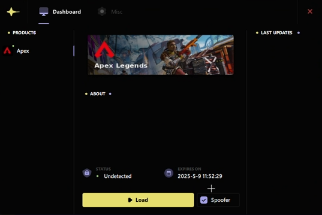

# \[APEX] ANC 輔助

## 輔助購買：https://fishboss.store/product/apex\_anc

***

## 一、前置作業

### 1. 依照不同顯卡 請裝好不同的驅動 教學點底下頁面


[nvidia-xian-ka-qian-zhi-zuo-ye.md](nvidia-xian-ka-qian-zhi-zuo-ye.md)



[amd-xian-ka-qian-zhi-zuo-ye.md](amd-xian-ka-qian-zhi-zuo-ye.md)


### 2. 請確保你有把 [通用前置作業四步驟](https://fishboss.gitbook.io/tutorial) 做完(尤其安全開機和TPM一定要關)

### 3. 開啟bios內的vt虛擬化功能


**請注意這邊此款輔助需要 \[開啟VT] 並 \[關閉Hyper-V]**



[xu-ni-hua-ji-shu-vt-yu-hyperv-ji-shu.md](../../instruction/preparation/xu-ni-hua-ji-shu-vt-yu-hyperv-ji-shu.md)


### 做完後，請繼續往下看

***

## 二、安裝輔助

### 1. 下載輔助

1. 去官網下載輔助檔案 [點我前往](https://cn.undetect.net/download/loader) 。
2. 右鍵管理員身分開啟輔助並且輸入卡密

> 每次開啟輔助，他會下載最新版檔案，並且隨機更改檔案名稱(亂碼)，建議創一個資料夾放輔助檔案，以免找不到。

<figure><figcaption></figcaption></figure>

3. 等待輔助加載\
   .png>)
4. 選擇遊戲(買什麼卡就選什麼遊戲)
5. 首次使用請先按\[F7按鍵] 並馬上按下下方\[Load按鈕] ，後面開都不用按\[F7按鍵]

> Spoofer=過機碼功能 | 機碼本身沒問題不建議開，這個大機率造成閃退、黑頻、電腦無限重開機等問題

<figure><figcaption></figcaption></figure>


**建議如果機碼本身沒問題 不用去開Spoofer 此功能不穩定性較高 安全演戲使用的話請不要打勾**



建議如果機碼本身沒問題 不用去開Spoofer 此功能不穩定性較高 安全演戲使用的話請不要打勾


6.  等待輔助加載 (需要一點時間，跑完之後請等待加載頁面消失)

    
<figure><figcaption></figcaption></figure>


如果有開過機碼功能會自動重啟電腦，重啟電腦後請再次打開輔助，做上方2\~5步驟)


7. 加載頁面消失後，直接去啟動遊戲
8. 好了，輔助裝好了，開一把去爽吧!


### 菜單按鍵：INS鍵 語言更改：可以選成中文 遊戲視窗：必須設置為 視窗化 / 無邊框


<figure><figcaption></figcaption></figure>

### 注意： 請確定電腦必要驅動都有裝，沒裝可以看下面文章

***

## 三、疑難排解

### 輔助無法啟動

* 輔助官方錯誤除錯方法：[點我前往](https://telegra.ph/ANCIENT-FAQ-CN-07-20)
* 請確保你有把 [通用前置作業四步驟](https://fishboss.gitbook.io/tutorial) 做完
* 查看[疑難排解](https://fishboss.gitbook.io/tutorial/instruction/faq)
* 關閉 安全開機
* **注意這邊此款輔助需要 \[開啟VT] 並 \[關閉Hyper-V]**
* 確保防毒程式已經關閉，這也包括特戰等反作弊程式

### 輔助開啟無反應 / 閃退 / 卡死

* 請確保你有把 [通用前置作業四步驟](https://fishboss.gitbook.io/tutorial) 做完
* 請更改系統例外語言為 英文(美國)
* 重新安裝顯卡驅動，安裝好重開機後重新注入輔助
* **注意這邊此款輔助需要 \[開啟VT] 並 \[關閉Hyper-V]**

***

## 聯繫我們

如有疑問，請聯繫：[官方Discord群](https://discord.com/invite/PwTKZGyAcA)
