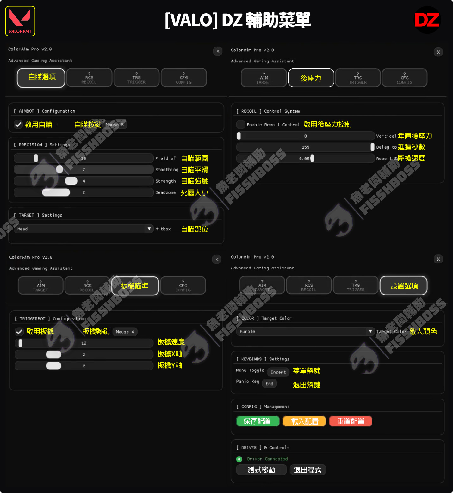

# \[特戰] DZ 找色自瞄 (正式版)


## 輔助購買：[https://fishboss.store/shop/valorant-dz/](https://fishboss.store/shop/valorant-dz/)


***

## 第一部分：三大前置作業(必須完整看完並且符合要求，<mark style="color:red;">否則100%無法使用</mark>)


[dezl-zhong-zhi-hua-shu.md](../dezl-cheat-1/dezl-zhong-zhi-hua-shu.md)



[dezl-qian-zhi-she-ding-bi-zuo.md](../dezl/dezl-qian-zhi-she-ding-bi-zuo.md)



[dezl-dian-nao-she-ding-bi-zuo.md](../dezl/dezl-dian-nao-she-ding-bi-zuo.md)


***

## 第二部分：安裝輔助

### 1. 下載輔助：[點我下載](https://mega.nz/folder/KyJnQLoS#YT6jiUl4OVoYqy2tmdAL2A)

<figure><figcaption></figcaption></figure>

### 2. 解壓縮檔案到C槽(檔案放置於純英文或數字的資料夾內)

<figure><figcaption></figcaption></figure>

### 3. 右鍵管理員身分打開輔助檔案

<figure><figcaption></figcaption></figure>

### 4. 登入輔助 > 輸入新版卡密 > ENTER

<figure><figcaption></figcaption></figure>

### 5. Color Select (<mark style="color:red;">必做</mark>，否則會造成自瞄沒效果)

> ### **開遊戲前必須先選擇好，並且在遊戲選擇**<mark style="color:red;">相同顏色</mark>

<figure><figcaption></figcaption></figure>

<figure><figcaption></figcaption></figure>


### 遊戲內敵人顏色必須和輔助這邊的COLOR設定一樣 否則無自瞄

### 遊戲內敵人顏色必須和輔助這邊的COLOR設定一樣 否則無自瞄

### 遊戲內敵人顏色必須和輔助這邊的COLOR設定一樣 否則無自瞄


### 6. 激活功能&#x20;

### 輔助菜單(INS鍵) > \[CFG分頁] > 按\[Connect Driver]

<figure><figcaption></figcaption></figure>

<figure><figcaption></figcaption></figure>

<figure><figcaption></figcaption></figure>

### 7. 打開遊戲&#x20;

### 先進入靶場測試與調整參數

> ### 輔助視窗無法縮小 直接打開遊戲即可 遊戲內如需調整 可直接alt+tab切回輔助畫面

### 8. 菜單熱鍵

### INS鍵(隱藏/顯示) | END鍵(退出輔助)

***

### 注意:

#### 建議<mark style="color:red;">只開啟Aimbot</mark>，其他後座力控制、暴力設定頁面的功能都別開(<mark style="color:red;">有封號風險</mark>)

***

## 輔助翻譯

<figure><figcaption></figcaption></figure>

***

## 疑難排解


[dezl-yi-nan-pai-jie.md](../dezl/dezl-yi-nan-pai-jie.md)

