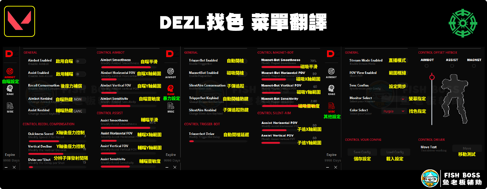

# DEZL 找色AI自瞄

## 輔助購買：[https://fishboss.store/product/dezl/](https://fishboss.store/product/dezl/)

***

## 第一部分：三大前置作業(必須完整看完 並且符合要求 否則無法使用)


[dezl-qian-zhi-she-ding-bi-zuo.md](dezl-qian-zhi-she-ding-bi-zuo.md)



[dezl-dian-nao-she-ding-bi-zuo.md](dezl-dian-nao-she-ding-bi-zuo.md)



[dezl-yi-lai-cheng-xu-bi-zuo.md](dezl-yi-lai-cheng-xu-bi-zuo.md)


***

## 第二部分：安裝輔助

### 1. 下載輔助：[點我下載](https://mega.nz/folder/KyJnQLoS#YT6jiUl4OVoYqy2tmdAL2A)

<figure><figcaption></figcaption></figure>

<figure><figcaption></figcaption></figure>

### 2. 解壓縮檔案到C槽(檔案放置於純英文或數字的資料夾內)

<figure><figcaption></figcaption></figure>

### 2-5. 確定已經安裝好依賴程序 (必須做)


[dezl-yi-lai-cheng-xu-bi-zuo.md](dezl-yi-lai-cheng-xu-bi-zuo.md)



### 務必注意

### 新版驅動必須安裝 沒裝輔助沒反應


### 3. 右鍵管理員身分打開輔助檔案Steam.exe(test.exe)

<figure><figcaption></figcaption></figure>

### 新卡號：需照下面流程註冊

### 4. 輔助註冊&#x20;

1.  首先 點選註冊按鈕

    
<figure><figcaption></figcaption></figure>

2.  輸入 \[帳號/密碼/密碼確認/卡號] 進行註冊

    
<figure><figcaption></figcaption></figure>

### 5. 登入輔助

<figure><figcaption></figcaption></figure>

### 6. HVCI支援功能

> ### 請依照本身電腦設定去開關此功能 如果HVCI(核心隔離)開，那這邊就要開 反之，HVCI(核心隔離)關，那這邊就要關


OFF：HVCI支援關閉 \
ON：HVCI支援啟用



### \[HVCI開啟] 輔助這邊必須 HVCI ON，否則輔助沒效果

### \[HVCI關閉] 輔助這邊必須 HVCI OFF，否則輔助沒效果


<figure><figcaption></figcaption></figure>

### 7. 滑鼠移動測試(這邊用來測試輔助是否有加載進滑鼠中)

> ### Move按下去，如果滑鼠沒有動。請檢查輔助是否有用管理員身分開啟，或是依賴程序(雷蛇驅動)版本錯誤

<figure><figcaption></figcaption></figure>

### 8. 建議開啟設置

#### \[STREAM MODE (繞過直播模式)]&#x20;

<figure><figcaption></figcaption></figure>

#### \[Color Select(找色顏色選擇)]

<figure><figcaption></figcaption></figure>

<figure><figcaption></figcaption></figure>


### 遊戲內敵人顏色必須和輔助這邊的COLOR設定一樣 否則無自瞄

### 遊戲內敵人顏色必須和輔助這邊的COLOR設定一樣 否則無自瞄

### 遊戲內敵人顏色必須和輔助這邊的COLOR設定一樣 否則無自瞄


### 9. 輔助縮小後開啟方法

<figure><figcaption></figcaption></figure>

#### 直播模式關閉：可在右下角找到輔助

<figure><figcaption></figcaption></figure>

#### 直播模式開啟：可在左下角找到輔助

<figure><figcaption></figcaption></figure>

### 10. 設置完畢，上遊戲爽

***

### 導入推薦參數：參數檔案必須和輔助執行檔放一起

<figure><figcaption></figcaption></figure>

### 檔案放一起後，在輔助Misc頁面按Load導入

<figure><figcaption></figcaption></figure>

### <mark style="color:green;background-color:yellow;">建議只開啟Assist或是Aimbot，其他後座力控制、暴力設定頁面的功能都別開</mark>

***

## 輔助翻譯

<figure><figcaption></figcaption></figure>

***

## 疑難排解


[dezl-yi-nan-pai-jie.md](dezl-yi-nan-pai-jie.md)

