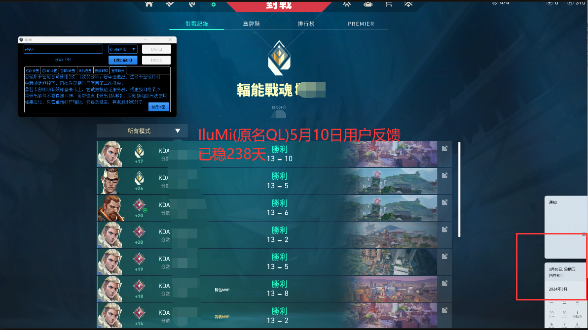

# 建議參數

<figure><figcaption></figcaption></figure>


## T1AAD Asuna參數推薦：

dpi 400 | 遊戲內靈敏度0.24 | 解析度1920\*1080\
部位設定的2 \
【一般情況範圍10，速度1，正常打】



## T1AAD Jiang參數推薦：&#x20;

dpi 400 | 遊戲內靈敏度0.38 | 解析度1920\*1080 \
部位設定的3 \
【一般狀況範圍20，速度3，正常打】



## T1AAD Tina 輻能參數推薦：

dpi400 | 遊戲內靈敏度1 | 解析度1920\*1080 \
部位設定的3 \
【一般情況範圍60， 速度3，正常打】 \
【打不過的時候範圍100，速度5，右鍵自瞄＋右鍵長按開鏡】




## 魚老闆自用參數：

### dpi 800 | 遊戲內靈敏度 0.3 | 解析度1920\*1080 設定如下圖


### 自瞄1 設左鍵 自己甩槍到敵人頭部附近 按下左鍵 幫你打上去

<figure><figcaption></figcaption></figure>

### 自瞄2 我用來開鏡架槍 範圍比較大 速度比較快 但要有頭線觀念 不然他平移過去也只打到身體 頭線觀念不好 可以把平移改成直線 部位3

<figure><figcaption></figcaption></figure>

### 板機設置 可開可不開 反應慢可以開 讓他幫你開火

<figure><figcaption></figcaption></figure>


